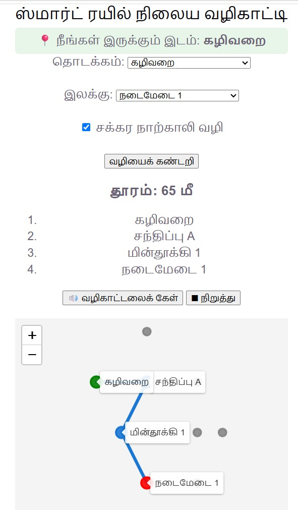
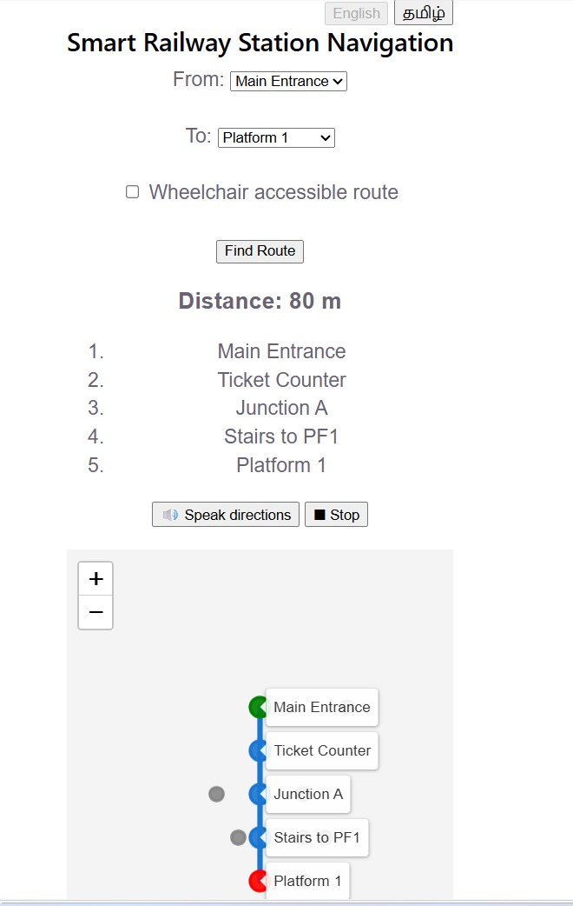
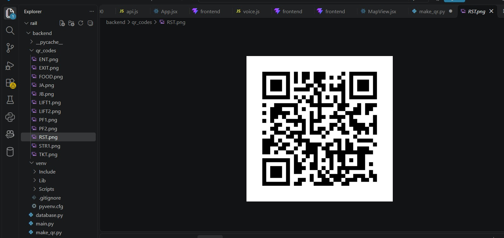
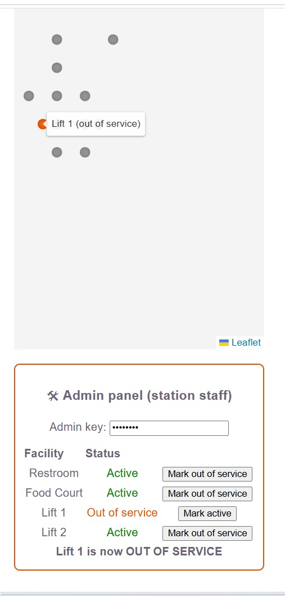
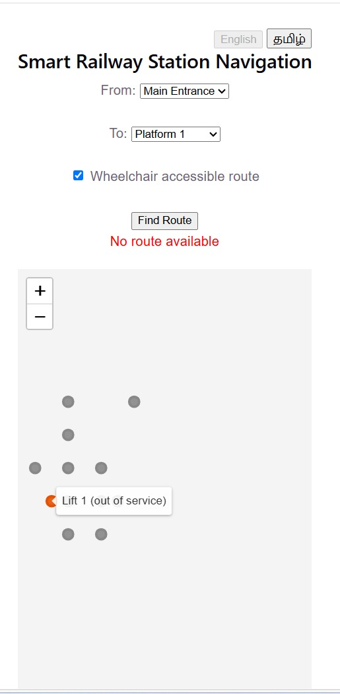
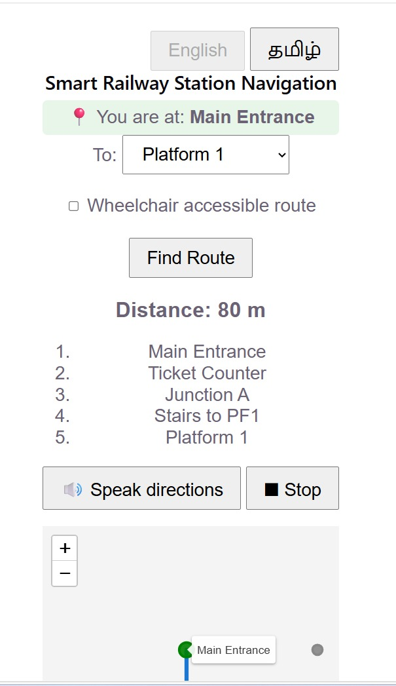
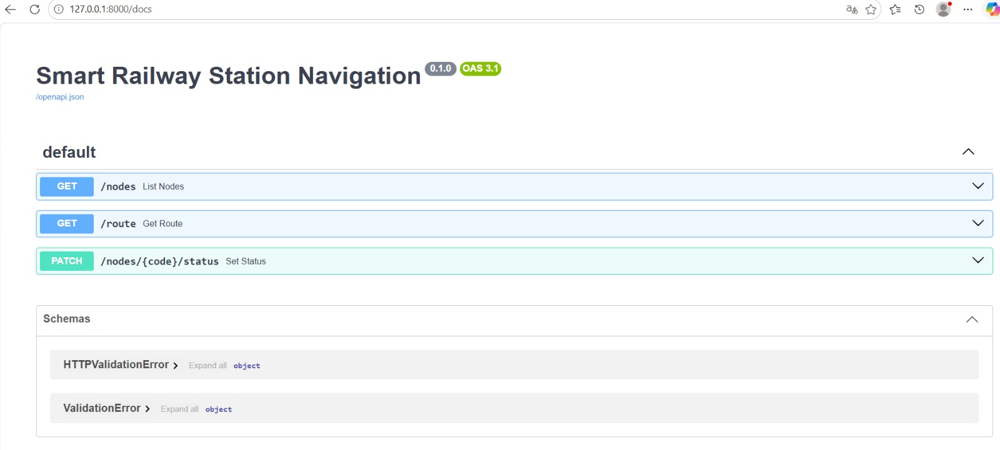

# Smart Railway Station Navigation System

A web app that helps passengers find platforms, ticket counters, restrooms,
lifts, food courts and exits inside a railway station, with wheelchair-accessible
routing, Tamil/English voice guidance, an admin panel and a kiosk mode.

Built for **SIH 1710: Enhancing Navigation for Railway Station Facilities and Locations** (Ministry of Railways).

## Features
- Shortest-path navigation using **Dijkstra's algorithm**
- **Wheelchair-accessible routes** (stair-free paths using lifts)
- **Tamil and English** interface and **voice guidance** (Web Speech API)
- **QR-code location entry**: scan a code in the station and the start point is set automatically
- Interactive station map with the route drawn (Leaflet)
- **Admin panel** (`/?admin=1`, protected by an admin key) to mark lifts and other facilities out of service; routes update immediately
- **Kiosk mode** (`/?kiosk=ENT`) with a fixed start location, large touch targets and auto-reset after 60 seconds of inactivity

## Tech Stack
| Layer | Technology |
|---|---|
| Frontend | React (Vite), Leaflet, Axios |
| Backend | Python, FastAPI, SQLAlchemy |
| Database | SQLite (switchable to PostgreSQL by changing one connection string) |
| Algorithm | Dijkstra with a priority queue (`heapq`) |
| Voice | Browser Web Speech API |
| QR codes | Python `qrcode` library |

## Page Modes
One web app, four ways to open it:

| Address | Who uses it | What happens |
|---|---|---|
| `/` | Any passenger | Normal page: choose start, destination and wheelchair option |
| `/?from=RST` | Passenger who scanned a QR code | Start point is set to the scanned place ("You are at: Restroom") |
| `/?kiosk=ENT` | Touch-screen kiosk at the Main Entrance | Start is fixed, text and buttons are larger, screen resets after 60 seconds without a touch |
| `/?admin=1` | Station staff | Shows the admin panel below the map |

`/?from=FOOD&to=PF2` also works and sets both the start and the destination.

## Screenshots
### Tamil interface, QR start location, wheelchair route (65 m)


### English interface, route using stairs (60 m)


### QR code placed at the Restroom


### Admin panel: Lift 1 marked out of service


### No wheelchair route while the only lift is out of service


### Kiosk mode


### API documentation (FastAPI Swagger)


## How It Works
1. The passenger scans a QR code (`/?from=RST`) or picks a start point.
2. The React app calls `GET /route?start=...&end=...&accessible=true`.
3. The backend builds a graph from the database and runs Dijkstra.
4. In wheelchair mode, edges with stairs are skipped.
5. Facilities marked out of service are left out of the graph.
6. The route is returned, drawn on the map, and can be read aloud.

## How to Run

### Backend
```bash
cd backend
python -m venv venv
venv\Scripts\activate
pip install -r requirements.txt
python seed_data.py
uvicorn main:app --reload
```
API docs: http://127.0.0.1:8000/docs

### Frontend
```bash
cd frontend
npm install
npm run dev
```
App: http://localhost:5173

### Generate QR codes
```bash
cd backend
python make_qr.py
```
The codes are saved in `backend/qr_codes/`.

## Admin Key
Changing a facility's status needs an admin key, sent in the `X-Admin-Key` header.

- The demo default is `admin123`.
- To use your own key, set the `ADMIN_KEY` environment variable before starting the backend.
- The key is typed into the admin panel and is not stored in the frontend code.

## API Endpoints
| Method | Endpoint | Purpose |
|---|---|---|
| GET | `/nodes` | List all places |
| GET | `/route?start=ENT&end=PF1&accessible=true` | Shortest route |
| PATCH | `/nodes/{code}/status?is_active=false` | Mark a facility out of service (needs `X-Admin-Key` header) |

## Limitations and Future Scope
- Station layout is a sample graph (12 places), not a real station
- 2D map only; 3D maps are future work
- The QR codes in this prototype point to `localhost`; for real use the app must be deployed to a public address and the codes regenerated
- The admin key is a simple demo mechanism; production needs proper authentication
- Tamil voice depends on the device having a Tamil text-to-speech voice
- Integration with railway apps and real-time crowd data are future work